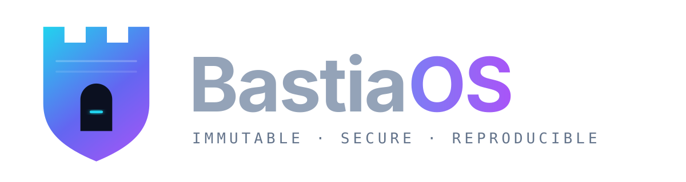

<div align="center">



### An immutable, secure-by-default and fully reproducible Linux distribution.

[](#-project-status)
[](docs/decisions/ADR-0001-build-system.md)
[](#-architecture)
[](docs/system/README.md)
[](#-license)

[Vision](#-vision) ·
[Features](#-key-features) ·
[Architecture](#-architecture) ·
[Quick Start](#-quick-start) ·
[Roadmap](#-roadmap) ·
[Contributing](#-contributing)

</div>

---

<p align="center">
  
  <br>
  <sub><i>Boot splash concept — BastiaOS 0.1 “Muralha”</i></sub>
</p>

## 🏰 Vision

A *bastião* (bastion) is the part of a fortress designed to be the hardest to breach. **BastiaOS** applies that idea to the desktop: a Linux system whose core is **read-only, verified at every boot, and rebuilt bit-for-bit from source**, while users keep full freedom on top of it.

Modern operating systems are moving toward image-based, atomic designs — but most of them are large, opaque or tied to a single vendor. BastiaOS aims to be the opposite: **small, transparent, auditable and understandable by a single person**.

> **Your system. Your fortress.**

## ✨ Key Features

> Features below describe the **target design**. See [Project Status](#-project-status) for what is implemented today.

| | Feature | Description |
|---|---|---|
| 🧱 | **Immutable core** | Read-only root filesystem; system changes happen only through signed image updates. |
| 🔁 | **Atomic A/B updates** | Updates are applied to an inactive slot and switched atomically, with automatic rollback on failure. |
| 🔐 | **Verified boot chain** | UEFI Secure Boot, Unified Kernel Images (UKI), dm-verity and TPM2-measured boot. |
| 🧬 | **Reproducible builds** | Same source, same bytes. Every artifact can be independently rebuilt and verified. |
| 📜 | **Supply-chain transparency** | SBOM generated for every release, pinned and checksummed sources. |
| 🪶 | **Minimal footprint** | Target of < 10 s boot and < 500 MB RAM at idle. |
| 🖥️ | **Wayland-native desktop** | Modern graphics stack with no legacy X11 dependency by default. |
| 📦 | **Sandboxed apps** | Applications delivered via Flatpak, isolated from the base system. |
| 📖 | **Documented decisions** | Every architectural choice is recorded as an [ADR](docs/decisions/README.md). |

## 🧩 Architecture

BastiaOS follows a layered design, where each layer is independent and replaceable:

```
┌──────────────────────────────────────────────────────────┐
│  Applications            Flatpak (sandboxed)             │
├──────────────────────────────────────────────────────────┤
│  Desktop                 Wayland compositor + shell      │
│  Graphics                Mesa · DRM/KMS                  │
├──────────────────────────────────────────────────────────┤
│  System Services         systemd · networking · updates  │
│  Userspace               coreutils · bash · BusyBox      │
├──────────────────────────────────────────────────────────┤
│  Root Filesystem         read-only image (A/B slots)     │
│  Initramfs               early userspace · verity setup  │
├──────────────────────────────────────────────────────────┤
│  Linux Kernel            custom config · signed UKI      │
│  Bootloader              GRUB2 → systemd-boot (planned)  │
├──────────────────────────────────────────────────────────┤
│  Toolchain & Build       Buildroot · glibc · ccache      │
└──────────────────────────────────────────────────────────┘
```

Current base configuration (see [`build/configs/bastiaos_defconfig`](build/configs/bastiaos_defconfig)):

| Component | Choice |
|---|---|
| Build system | [Buildroot](https://buildroot.org) `2024.02.2` — [ADR-0001](docs/decisions/ADR-0001-build-system.md) |
| Target | `x86_64` |
| C library | glibc |
| Init | systemd |
| Kernel | Latest stable Linux |
| Bootloader | GRUB2 |
| Root filesystem | ext4 |

## 🚀 Quick Start

### Requirements

A Linux host with `git`, `wget`, `tar`, `make`, `gcc`, `python3` and, for testing, `qemu-system-x86_64`.

### Build

```bash
git clone <repository-url> bastiaos
cd bastiaos

# Download and prepare Buildroot
./scripts/setup-buildroot.sh

# Apply the BastiaOS configuration
cd build/buildroot
cp ../configs/bastiaos_defconfig .config

# (optional) customize
make menuconfig

# Build the full system
make -j"$(nproc)"
```

### Run in QEMU

```bash
qemu-system-x86_64 \
    -kernel output/images/bzImage \
    -drive file=output/images/rootfs.ext2,format=raw \
    -append "root=/dev/sda console=ttyS0" \
    -nographic \
    -m 512M
```

More details in [`build/README.md`](build/README.md) and [`docs/development/buildroot-setup.md`](docs/development/buildroot-setup.md).

## 📍 Project Status

🚧 **Pre-Alpha** — the project is in its foundation phase. The build system has been selected and an initial Buildroot configuration is in place. BastiaOS is **not** suitable for production use.

## 🗺️ Roadmap

<details open>
<summary><b>Phase 1 — Foundation</b></summary>

- [x] Select build system ([ADR-0001](docs/decisions/ADR-0001-build-system.md))
- [x] Initial Buildroot configuration
- [ ] Cross-compilation toolchain
- [ ] Minimal bootable system in QEMU
- [ ] Reproducible build pipeline (CI)

</details>

<details>
<summary><b>Phase 2 — Core System</b></summary>

- [ ] Kernel configuration and hardening
- [ ] systemd integration
- [ ] Filesystem layout
- [ ] Networking stack

</details>

<details>
<summary><b>Phase 3 — Immutable & Verified Boot</b></summary>

- [ ] Read-only root with dm-verity
- [ ] A/B image updates with rollback
- [ ] Unified Kernel Images + Secure Boot signing
- [ ] TPM2 measured boot
- [ ] Boot splash (Plymouth) using the BastiaOS theme

</details>

<details>
<summary><b>Phase 4 — Graphics & Desktop</b></summary>

- [ ] Wayland compositor
- [ ] Mesa / DRM graphics stack
- [ ] Desktop environment selection
- [ ] Display manager

</details>

<details>
<summary><b>Phase 5 — User Experience</b></summary>

- [ ] Flatpak integration
- [ ] System configuration tools
- [ ] Installer

</details>

<details>
<summary><b>Phase 6 — Testing & Release</b></summary>

- [ ] Automated boot tests (QEMU)
- [ ] Reproducibility verification
- [ ] SBOM and vulnerability scanning
- [ ] Performance tuning
- [ ] First public release — **0.1 “Muralha”**

</details>

## 🧭 Development Philosophy

```
Design → Build → Test → Document → Improve
```

1. **Reproducibility** — all builds must be reproducible from source.
2. **Transparency** — decisions are documented in ADRs.
3. **Modularity** — components are independent and replaceable.
4. **Simplicity** — no unnecessary complexity.
5. **User control** — the user always owns their system.

## 🗂️ Repository Structure

```
bastiaos/
├── assets/
│   └── branding/          # Logo, icon and boot splash
├── build/
│   ├── configs/           # Buildroot defconfig
│   ├── linux/             # Kernel configuration
│   └── package/           # Package overrides (BusyBox, ...)
├── docs/
│   ├── architecture/      # System architecture
│   ├── decisions/         # Architecture Decision Records (ADRs)
│   ├── development/       # Developer guides
│   └── ...                # boot, kernel, security, testing, etc.
└── scripts/               # Setup and utility scripts
```

## 🧪 Testing Strategy

- Unit tests for individual components
- Integration tests for system services
- Automated boot tests in QEMU
- Reproducibility checks on build artifacts
- Security and vulnerability scanning

See [`docs/testing`](docs/testing/README.md).

## 🛡️ Security

- Minimal attack surface through a small base system
- Secure defaults and strict file permissions
- Verified, signed boot chain (planned)
- Regular updates and audits

Please report vulnerabilities privately — see [`docs/security`](docs/security/README.md).

## 🎨 Branding

| Asset | File |
|---|---|
| Logo (horizontal) | [`assets/branding/logo.svg`](assets/branding/logo.svg) |
| Icon / mark | [`assets/branding/logo-mark.svg`](assets/branding/logo-mark.svg) |
| Boot splash (1920×1080) | [`assets/branding/boot-splash.svg`](assets/branding/boot-splash.svg) |

PNG exports are available alongside each SVG.

**Palette:** `#22D3EE` Cyan · `#6366F1` Indigo · `#A855F7` Violet · `#0B1020` Night

## 🤝 Contributing

Contributions are welcome!

1. Read the documentation in [`docs/`](docs/README.md)
2. Check existing [ADRs](docs/decisions/README.md) for relevant decisions
3. Open an issue (or an ADR) for significant changes
4. Follow the existing code style
5. Include tests and update documentation
6. Submit a pull request

## 📄 License

To be determined. The project will likely adopt a permissive open-source license.

---

<div align="center">
  
  <br>
  <sub><b>BastiaOS</b> — Design → Build → Test → Document → Improve</sub>
</div>
