<div align="center">


### A lightweight, secure-by-default Linux distribution built on Ubuntu LTS.

[](#-project-status)
[](docs/architecture/proposta-arquitetura-ubuntu.md)
[](docs/architecture/proposta-arquitetura-ubuntu.md)
[](#-architecture)
[](#-license)

[Vision](#-vision) ·
[Features](#-key-features) ·
[Architecture](#-architecture) ·
[Roadmap](#-roadmap) ·
[Contributing](#-contributing)

</div>

---

<p align="center">
  
  <br>
  <sub><i>Boot splash concept — BastiaOS 0.1 “Muralha”</i></sub>
</p>

## 🏰 Vision

A *bastião* (bastion) is the part of a fortress designed to be the hardest to breach. **BastiaOS** applies that idea to the desktop: a clean, fast and private Linux system that keeps the proven core of **Ubuntu LTS** — kernel, signed boot chain, drivers and security updates — and curates everything on top of it.

No silent snaps, no telemetry, no background services without a reason. Every choice is measured, documented and reversible by the user.

> **Your system. Your fortress.**

## ✨ Key Features

> Features below describe the **target design** from the [architecture proposal](docs/architecture/proposta-arquitetura-ubuntu.md). They become commitments only once the matching ADRs are accepted ([STEP 01](docs/steps/STEP-01-decisoes-de-arquitetura-adrs.md)).

| | Feature | Description |
|---|---|---|
| 🧱 | **Ubuntu LTS core** | Ubuntu 26.04 LTS `main` + `universe`, HWE kernel, untouched packages from the Ubuntu archive. |
| 🔐 | **Secure Boot out of the box** | shim, GRUB and kernel signed by Canonical — no custom keys required. |
| 🪶 | **Lightweight Xfce desktop** | Xfce 4.20 with a curated selection, measured against Xubuntu Minimal. |
| 📦 | **No silent snaps** | `snapd` not preinstalled; Flatpak + Flathub enabled; snap stays one `apt install` away. |
| 🧬 | **Reproducible builds** | Own pipeline (mmdebstrap + `snapshot.ubuntu.com`), runnable in CI. |
| 🙈 | **Private by default** | No apport, whoopsie or ubuntu-report; no telemetry. |
| 🛠️ | **Ready for developers** | `bastia-devsetup` installs development profiles on demand. |
| 📖 | **Documented decisions** | Every structural choice is recorded as an [ADR](docs/decisions/README.md). |

## 🧩 Architecture

```
┌──────────────────────────────────────────────────────────┐
│  User apps          APT (Ubuntu + PPAs) · Flatpak/Flathub │
│                     snap (optional, explicit)             │
├──────────────────────────────────────────────────────────┤
│  BastiaOS (own PPA) bastia-base · bastia-desktop          │
│                     bastia-desktop-settings · artwork     │
│                     bastia-devsetup                       │
├──────────────────────────────────────────────────────────┤
│  Desktop            Xorg · Xfce 4.20 · LightDM            │
├──────────────────────────────────────────────────────────┤
│  Ubuntu 26.04 LTS   HWE kernel · shim + GRUB (signed)     │
│                     systemd · AppArmor · NetworkManager   │
│                     PipeWire · Mesa · firmware            │
└──────────────────────────────────────────────────────────┘
```

| Layer | Proposed choice |
|---|---|
| Base | Ubuntu 26.04 LTS (`main` + `universe`), `linux-generic-hwe-26.04` |
| Boot | shim + GRUB + kernel signed by Canonical |
| Security | AppArmor (Ubuntu profiles), ufw deny-incoming |
| Desktop | Xorg + Xfce 4.20 + LightDM GTK greeter |
| Packages | APT; own Launchpad PPA |
| Apps | Flatpak + Flathub; snap available, not installed |
| Installer | Calamares |
| Filesystem | ext4 (Btrfs + snapshots after beta) |
| Build | mmdebstrap + snapshot.ubuntu.com → casper → xorriso |

Full rationale, comparisons with Debian, Fedora, Arch, NixOS and Gentoo, and the decisions pending validation: [`docs/architecture/proposta-arquitetura-ubuntu.md`](docs/architecture/proposta-arquitetura-ubuntu.md).

## 📍 Project Status

🚧 **Pre-Alpha — E0 Foundation.** The architecture has been redefined around Ubuntu LTS. There is nothing to build yet: the build infrastructure arrives in [STEP 03](docs/steps/STEP-03-infraestrutura-de-build.md). BastiaOS is **not** suitable for any use.

Earlier experiments are preserved in Git tags under `archive/` — see the [CHANGELOG](CHANGELOG.md).

## 🗺️ Roadmap

Work follows numbered STEPs; only the lowest STEP not yet ✅ is worked on. Full list and status: [`docs/steps/README.md`](docs/steps/README.md).

| Stage | STEPs | Exit gate |
|---|---|---|
| E0 Foundation | 00–04 | **G0** single architecture, license, CI, reference baselines |
| E1 Minimal system | 05–07 | **G1** reproducible live ISO with Secure Boot + working PPA |
| E2 Desktop | 08–12 | **G2** full desktop, app store and updates |
| E3 Product | 13–15 | **G3** dev environment, measured footprint, visual identity |
| E4 Delivery | 16–19 | **G4** public beta |

## 🧭 Development Philosophy

```
Design → Build → Test → Document → Improve
```

1. **Measure before claiming** — targets are set from benchmarks of the reference distributions.
2. **Nothing runs without a reason** — every service is inventoried and justified.
3. **Decisions in ADRs** — no structural change without an accepted ADR.
4. **Docs in the same PR** — documentation is part of the definition of done.
5. **User control** — sensible defaults, never locked-in choices.

## 🗂️ Repository Structure

```
bastiaos/
├── assets/
│   └── branding/          # Logo, icon and boot splash
└── docs/
    ├── architecture/      # Architecture proposal and design documents
    ├── decisions/         # Architecture Decision Records (ADRs)
    ├── steps/             # Implementation STEPs 00–19
    └── ...                # boot, security, testing, etc.
```

## 🛡️ Security

- Ubuntu security updates via `unattended-upgrades`
- AppArmor and ufw always enabled
- Signed boot chain inherited from Ubuntu
- Minimal set of services, each one justified

Please report vulnerabilities privately — see [`docs/security`](docs/security/README.md).

## 🎨 Branding

| Asset | File |
|---|---|
| Logo (horizontal) | [`assets/branding/logo.svg`](assets/branding/logo.svg) |
| Icon / mark | [`assets/branding/logo-mark.svg`](assets/branding/logo-mark.svg) |
| Boot splash (1920×1080) | [`assets/branding/boot-splash.svg`](assets/branding/boot-splash.svg) |

PNG exports are available alongside each SVG.

**Palette:** `#22D3EE` Cyan · `#6366F1` Indigo · `#A855F7` Violet · `#0B1020` Night

## 🤝 Contributing

Contributions are welcome once the license is defined (STEP 01–02).

1. Read the [STEPs](docs/steps/README.md) and the [architecture proposal](docs/architecture/proposta-arquitetura-ubuntu.md)
2. Check existing [ADRs](docs/decisions/README.md) for relevant decisions
3. Open an issue (or an ADR) for significant changes
4. Include tests and update documentation in the same PR

## 📄 License

To be defined in ADR-0006 ([STEP 01](docs/steps/STEP-01-decisoes-de-arquitetura-adrs.md)) and applied in [STEP 02](docs/steps/STEP-02-governanca-e-documentacao-do-repositorio.md). Until then, no license is granted.

---

<div align="center">
  
  <br>
  <sub><b>BastiaOS</b> — Design → Build → Test → Document → Improve</sub>
</div>
