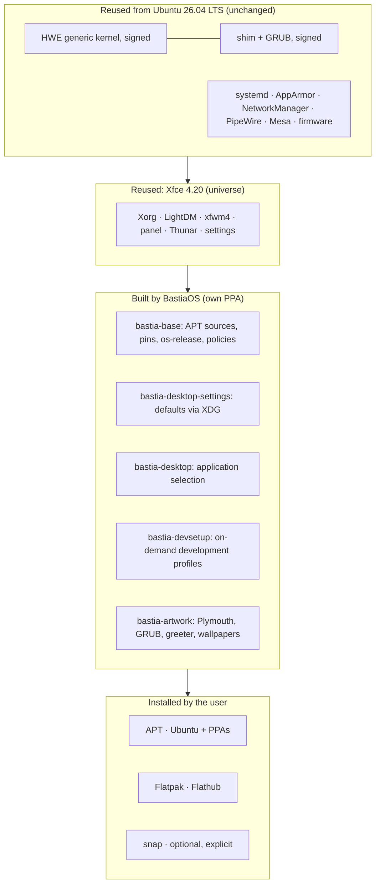

# BastiaOS Architecture

BastiaOS is a curated distribution built on **Ubuntu 26.04 LTS** with the **Xfce 4.20** desktop. It does not fork or rebuild Ubuntu components: the project selects packages from the Ubuntu archive, configures them and ships its own `bastia-*` packages on top.

## Layers

## Decisions

| Topic | Decision | ADR |
|---|---|---|
| Base and desktop | Ubuntu 26.04 LTS + Xfce 4.20 (X11) | [ADR-0002](../adr/0002-base-ubuntu-xfce.md) |
| Build pipeline | mmdebstrap + snapshot.ubuntu.com → casper → xorriso | [ADR-0003](../adr/0003-pipeline-de-build.md) |
| Applications | No preinstalled snapd; Flatpak + Flathub; Firefox from Mozilla's APT repository | [ADR-0004](../adr/0004-politica-snap-flatpak.md) |
| Installer | Calamares, ext4 by default | [ADR-0005](../adr/0005-instalador-calamares.md) |
| License | GPL-2.0-or-later, CC BY-SA 4.0, trademark policy | [ADR-0006](../adr/0006-licenca.md) |
| Versioning and support | SemVer, MAJOR = Ubuntu base; 1.x until 04/2029 | [ADR-0007](../adr/0007-versionamento-e-suporte.md) |
| Own packages | Launchpad PPA | [ADR-0008](../adr/0008-repositorio-ppa.md) |

The research behind these decisions — audit, comparisons, application and service selection — is in [`proposta-arquitetura-ubuntu.md`](proposta-arquitetura-ubuntu.md).

## Deferred until after the beta

- Btrfs with snapshots as an installer option
- Wayland session, once `xfwl4` is usable
- Rebase to Ubuntu 28.04 LTS
- arm64

## Related Documentation

- [Architecture Decision Records](../adr/README.md)
- [Implementation STEPs](../steps/README.md)
- [Testing Strategy](../testing/README.md)
