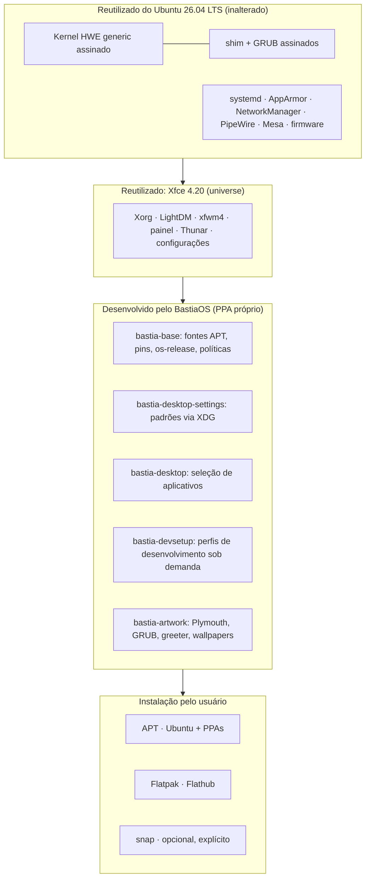

# BastiaOS — Auditoria, Arquitetura Ubuntu e Roadmap Definitivo

> **Status:** Proposta para validação — STEP 00 aplicado (Buildroot arquivado em `archive/buildroot`); ADRs pendentes no STEP 01.
> **Data:** 2026-11-14 · **Base auditada:** `ORDEM-DE-IMPLANTACAO.md` (auditoria de `main` @ `7d8d8f9`)
> **Substitui, se aprovada:** Plano Mestre v2 (Debian + mkosi + labwc) e a ordem S00–S49.

---

## Parte 1 — Auditoria do projeto

### 1.1 Inventário do que existe

| Item | Onde | Estado | Destino na nova arquitetura |
|---|---|---|---|
| Repositório público | GitHub `bastiaos` | ⚠️ sem licença, sem proteção de `main`, sem CI | **Preservar e corrigir** (STEP 02) |
| Marca: logo, ícone, boot splash | `assets/branding/` | ✅ existe | **Preservar** — vira Plymouth, GRUB, greeter (STEP 15) |
| Site institucional | repo `BastiaOS-Site` (Pages) | ✅ existe | **Preservar** como landing; docs técnicas separadas |
| README profissional | `README.md` | 🟡 anuncia decisões não tomadas (GRUB × systemd-boot, ext4 × Btrfs, A/B × snapper) | **Reescrever** a seção técnica após ADRs (STEP 01–02) |
| Script de setup | `scripts/setup-buildroot.sh` | 🟡 específico de Buildroot | **Arquivar** |
| Configs Buildroot | `build/configs/bastiaos_defconfig`, `build/linux/bastiaos.config`, `build/package/busybox/` | ⚠️ nunca compiladas | **Arquivar** (tag `archive/buildroot`) |
| ADR-0001 | `docs/adr/` | ⚠️ *Accepted* escolhendo Buildroot | **Substituir** por ADR-0002 (base Ubuntu) |
| Host de laboratório | máquina local | ✅ KVM, QEMU 10.2.1, OVMF com variantes Secure Boot, Docker 29.9.3 | **Preservar** — já atende STEP 04 |
| Pacote S02 (gerado no chat) | fora do repo | ⚠️ nunca aplicado | **Reaproveitar seletivamente** (CONTRIBUTING, SECURITY, templates, MkDocs); **descartar** o logo de fortaleza para não haver duas identidades |
| Entregáveis da Phase 0 (Makefile, Dockerfile, CI, validate-env) | — | ⚠️ planejados, mas **não estão no repositório** | **Recriar** para Ubuntu (STEP 03) |
| Plano Mestre v2 / ordem S00–S49 | docs | ⚠️ arquitetura Debian+mkosi incompatível com o novo objetivo | **Substituir** pelo roadmap desta proposta; manter princípios |

### 1.2 Problemas arquiteturais encontrados

| # | Problema | Gravidade | Correção |
|---|---|---|---|
| A1 | Repositório público **sem licença** | Alta — bloqueia contribuição legal | STEP 02, antes de qualquer código |
| A2 | Três arquiteturas coexistindo: Buildroot (ADR-0001), Debian+mkosi (Plano v2) e agora Ubuntu | Alta — decisões contraditórias | STEP 00–01: uma única arquitetura registrada |
| A3 | README e site prometem tecnologias não decididas | Média — expectativa errada | STEP 02 |
| A4 | Status "concluído" sem artefato no repo (S00/S01) | Média — planejamento descolado da realidade | Regra: step só ✅ com commit em `main` |
| A5 | Duas identidades visuais possíveis | Baixa | Manter `assets/branding/` existente |
| A6 | Ausência de CI e Makefile | Média | STEP 03 |

### 1.3 O que se preserva dos planos anteriores

Mudam as tecnologias, mas os princípios continuam valendo:

- Nada roda sem justificativa: inventário de serviços.
- Medir antes de afirmar: protocolo de benchmark.
- ADR para toda decisão estrutural.
- Portões entre etapas.
- Documentação no mesmo PR.
- Testes em VM a cada mudança.

### 1.4 O que deixa o caminho crítico

A **Trilha L** (kernel compilado à mão, BusyBox, Buildroot) não contribui para uma distribuição baseada em Ubuntu, que usa o kernel assinado da Canonical. Ela vira **trilha de estudo opcional**, sem bloquear nenhum step.

---

## Parte 2 — Escolha da distribuição-base

### 2.1 Fatos relevantes do ciclo atual (Ubuntu 26.04 LTS "Resolute Raccoon")

| Fato | Implicação |
|---|---|
| Lançado em 23/04/2026 com kernel Linux 7.0 | Base de hardware recente |
| Ubuntu Desktop (GNOME 50) agora recomenda no mínimo 6 GB de RAM e removeu a sessão Xorg | GNOME não serve como base "leve" |
| Xubuntu 26.04 traz Xfce 4.20; suporte de 3 anos (até abril de 2029) | Xfce maduro em LTS; janela de suporte do sabor é menor que a do Ubuntu principal |
| Existe ISO **Xubuntu Minimal** separada (~3,0 GB × 4,8 GB da Desktop), sem snaps, sendo simples remover o snapd | Referência direta para "Ubuntu limpo" |
| Xubuntu Desktop 26.04 ainda usa Firefox, Thunderbird e loja em **snap** | É preciso uma política própria de pacotes |
| Xfce 4.20: Wayland experimental; xfwm4 continua somente X11; o compositor nativo (xfwl4) ainda não é utilizável | Desktop em **X11** durante todo o ciclo 26.04 |
| Lubuntu 26.04: LXQt 2.3, Qt 6, loja Discover, Firefox snap; sessão Wayland não entrou no archive | LXQt também roda em X11 neste ciclo; Discover traz dependências KDE |
| Lubuntu usa **Calamares**; os demais sabores migraram para o instalador Flutter/subiquity da Canonical | Existe um instalador alternativo maduro, dentro do archive Ubuntu |
| O Ubuntu oferece **snapshot.ubuntu.com**: o archive como estava em qualquer data | Builds reprodutíveis possíveis |

### 2.2 Comparação técnica das opções

| Critério | Ubuntu Desktop (GNOME) | Xubuntu Desktop | Xubuntu Minimal | Lubuntu (LXQt) | **Ubuntu mínimo + Xfce curado (proposta)** |
|---|---|---|---|---|---|
| RAM idle | Alta (requisito de 6 GB) | Média-baixa | Baixa | Baixa | **Baixa**, controlada por inventário |
| CPU idle | Média (GNOME Shell, tracker) | Baixa | Baixa | Baixa | Baixa |
| Armazenamento | ISO 5,9 GB | ISO 4,8 GB | ISO 3,0 GB | Médio | Alvo < Xubuntu Minimal + LibreOffice |
| Estabilidade | Máxima (5 anos) | Alta (3 anos de sabor) | Alta | Alta | Alta: núcleo Ubuntu `main` + Xfce `universe` |
| Hardware | Excelente | Excelente (mesmo kernel/firmware) | Excelente | Excelente | Excelente (kernel HWE e shim assinados intocados) |
| Manutenção para você | Baixa, mas fora do objetivo | Baixa | Baixa | Baixa | Média: você mantém seeds, metapacotes e configs |
| Personalização | Limitada pela visão Canonical | Alta | Alta | Alta | **Total sobre a seleção**, sem fork de componentes |
| Snap | Integrado | Integrado | Ausente | Firefox snap | **Ausente por padrão** (ADR) |
| Wayland em 26.04 | Sim | Experimental | Experimental | Não | X11 (Wayland quando o xfwl4 amadurecer) |
| Instalador | Flutter (requer snap) | Flutter | Flutter | Calamares | **Calamares** |

### 2.3 Xfce × LXQt (o ponto de decisão real)

| Aspecto | Xfce 4.20 | LXQt 2.3 |
|---|---|---|
| Maturidade e coesão | Muito alta; configurações completas e integradas | Boa; algumas ferramentas vêm de outros projetos |
| Integração com LibreOffice e Firefox (GTK) | Nativa (mesmo toolkit) | Mistura Qt + GTK, temas duplicados |
| Consumo | Baixo | Ligeiramente menor (a medir) |
| Loja de apps natural | GNOME Software (GTK) | Discover (puxa bibliotecas KDE) |
| Caminho Wayland | xfwl4 em desenvolvimento | Sessão funciona upstream, mas não empacotada no 26.04 |
| Referência no Ubuntu | Xubuntu Minimal, a mais próxima do objetivo | Lubuntu |

**Recomendação: Xfce.** Coesão GTK com os aplicativos essenciais, maturidade e o Xubuntu Minimal como baseline mensurável. LXQt fica registrado como alternativa no ADR, com critério de revisão: se a RAM idle medida no STEP 04 for mais de 25% menor no Lubuntu, a decisão é reaberta.

### 2.4 Construção: por que não "remasterizar o Xubuntu"

| Método | Prós | Contras | Veredito |
|---|---|---|---|
| Cubic / remaster manual de ISO | Rápido | Não reproduzível; não roda em CI; herda escolhas alheias | ❌ |
| Remaster da ISO Xubuntu Minimal | Mantém o instalador oficial | Imagem em camadas de squashfs + instalador Flutter distribuído como snap: frágil e contradiz a política sem snap | ❌ |
| livecd-rootfs (ferramenta oficial dos sabores) | É o que o Ubuntu usa | Acoplado à infraestrutura Launchpad/cdimage; curva alta | ⚠️ só como referência |
| **Pipeline próprio: mmdebstrap + snapshot.ubuntu.com → casper → Calamares → shim/GRUB assinados → xorriso** | Reproduzível, roda no CI, controle total da seleção, boot assinado do Ubuntu intacto | Mais trabalho inicial | ✅ **Recomendado** |

Precedente: Linux Mint, Pop!_OS e elementary OS também derivam do Ubuntu com ferramentas próprias, e não com o instalador oficial.

### 2.5 Arquitetura recomendada

| Camada | Decisão | Classe |
|---|---|---|
| Base | Ubuntu 26.04 LTS, `main` + `universe`, kernel `linux-generic-hwe-26.04` | REUSE |
| Boot | shim + GRUB + kernel **assinados pela Canonical**: Secure Boot funciona sem chaves próprias | REUSE |
| Init / segurança | systemd, AppArmor (perfis Ubuntu), ufw ativado com entrada negada | REUSE / CONFIGURE |
| Gráfico | Xorg + Xfce 4.20 + LightDM (greeter GTK) | REUSE / CONFIGURE |
| Áudio e rede | PipeWire + WirePlumber; NetworkManager + nm-applet | REUSE |
| Pacotes do sistema | APT; repositório próprio em **Launchpad PPA** | REUSE / BUILD |
| Aplicativos | Flatpak + Flathub ativos; snap disponível mas não instalado | CONFIGURE |
| Loja | GNOME Software com plugin Flatpak, sem plugin snap | REUSE / CONFIGURE |
| Instalador | Calamares, partindo da configuração do Lubuntu (`calamares-settings-lubuntu`) | REUSE / CONFIGURE |
| Filesystem | ext4 padrão (testado pelo Ubuntu); Btrfs + snapshots pós-beta | DEFER |
| Configurações padrão | via `XDG_CONFIG_DIRS` (mesmo padrão do `xubuntu-default-settings`): atualizáveis sem sobrescrever `~` | BUILD |

### 2.6 Política de snap (decisão sensível)

O objetivo é **liberdade sem surpresa**.

- `snapd` **não** é pré-instalado.
- Os pacotes de transição do Ubuntu que instalam snaps silenciosamente via APT (`firefox`, `thunderbird`, `chromium-browser`) recebem pin `-1` vindo do archive Ubuntu.
- O `snapd` em si **não** é bloqueado. Quem quiser snap roda `sudo apt install snapd` conscientemente.

Isso é diferente do Linux Mint, que bloqueia o snapd inteiro. Lá, a justificativa foi que o pacote Chromium era vazio e conectava o computador à Snap Store sem consentimento. O BastiaOS resolve o mesmo problema bloqueando só a instalação silenciosa, sem restringir o usuário.

**Firefox:** pacote `.deb` do repositório APT oficial da Mozilla, com pin de prioridade 1000. Sem esse pin, o pacote de transição do Ubuntu reinstala o snap. Há fontes divergentes sobre o canal rapid-release em 26.04, então o STEP 07 valida antes de fixar a escolha (rapid-release × ESR).

### 2.7 Janela de suporte

- Pacotes de `main` (kernel, systemd, bibliotecas base): suporte padrão de 5 anos.
- Xfce está em `universe`: o sabor Xubuntu garante 3 anos (até abril de 2029).

**Consequência:** BastiaOS 1.x sobre 26.04 deve planejar suporte até abril de 2029 e o rebase para 28.04 LTS. Registrar no ADR de versionamento.

### 2.8 Comparação com as distribuições de referência

| Decisão | Ubuntu | Debian | Fedora | Arch | NixOS | Gentoo | BastiaOS |
|---|---|---|---|---|---|---|---|
| Apps de terceiros | Snap | Flatpak opcional | Flatpak (Fedora Flathub) | AUR / Flatpak | Nix / Flatpak | ebuild / Flatpak | **Flatpak + APT** |
| Instalador | Flutter/subiquity | d-i / Calamares (live) | Anaconda | archinstall | Calamares (gráfico) | Manual | **Calamares** |
| Secure Boot | Assinado | Assinado | Assinado | Manual | Manual | Manual | **Herdado do Ubuntu** |
| Builds reprodutíveis | Snapshot service | snapshot.debian.org | Parcial | Repro project | Nativo | Local | **snapshot.ubuntu.com** |

---

## Parte 3 — Seleção de aplicativos e serviços

### 3.1 Aplicativos essenciais

| Função | Escolha | Alternativa avaliada | Status |
|---|---|---|---|
| Navegador | Firefox (deb Mozilla) | Chromium (só snap no Ubuntu) | Incluído |
| Escritório | LibreOffice Writer, Calc, Impress, Draw + `libreoffice-gtk3` + `l10n-pt-br` + `help-pt-br` | Suíte completa | Incluído; **Base e Math via loja** (Base depende de Java em partes) |
| Arquivos | Thunar + `thunar-archive-plugin` + `thunar-volman` + `gvfs-backends` (rede, MTP) | PCManFM | Incluído |
| Terminal | xfce4-terminal | Alacritty | Incluído |
| Editor de texto | Mousepad 0.7 | Gedit (libadwaita) | Incluído |
| PDF | Atril | Papers/Evince (GNOME, mais pesado) | Incluído |
| Imagens | Ristretto | — | Incluído |
| Configurações | xfce4-settings + lightdm-gtk-greeter-settings | — | Incluído |
| Captura de tela | xfce4-screenshooter | Flameshot | Incluído |
| Compactador | Engrampa + `7zip` + `unar` | File Roller | Incluído |
| Atualizações | GNOME Software (APT + Flatpak) + `unattended-upgrades` (segurança) | update-manager | Incluído — decisão final medida no STEP 12 |
| Loja | GNOME Software + `gnome-software-plugin-flatpak` | Discover, App Center (snap) | Incluído |
| Drivers | `ubuntu-drivers-common` + aba "Drivers adicionais" (`software-properties-gtk`) | — | Incluído |
| Rede | network-manager-gnome, plugins OpenVPN/WireGuard | — | Incluído |
| Bluetooth | Blueman | — | Incluído |
| Impressão | CUPS (socket-activated) + system-config-printer | — | Incluído |
| Firmware | fwupd (timer) | — | Incluído |
| Mídia | Parole ou mpv | VLC | **Opcional** (pacote `bastia-multimedia`) |
| E-mail | — | Thunderbird | **Via loja** |

### 3.2 Ambiente de desenvolvimento

O sistema vem "pronto para desenvolver", mas instala o mínimo. As ferramentas específicas ficam em perfis instalados sob demanda.

| Camada | Conteúdo | Por padrão? |
|---|---|---|
| `bastia-base` | git, curl, wget, ca-certificates, openssh-client, gnupg, zip/unzip, python3 | ✅ Sim: pequeno e universal |
| `bastia-dev-essentials` | build-essential, pkg-config, cmake, make | Opcional (oferecido no primeiro login) |
| `bastia-dev-web` | Node.js LTS por gerenciador de versão por usuário (fnm) ou NodeSource | Opcional |
| `bastia-dev-python` | python3-venv, pipx, python3-dev | Opcional |
| `bastia-dev-java` | default-jdk (OpenJDK do archive) | Opcional |
| `bastia-dev-containers` | docker.io + docker-compose-v2 (archive, atualizações via Ubuntu) **ou** Docker CE; `docker.socket` em vez do daemon sempre ativo | Opcional |
| `bastia-dev-db` | PostgreSQL do archive com serviço **desativado** por padrão (preferência: em contêiner) | Opcional |
| Editores | VS Code (repositório APT da Microsoft, `signed-by`) ou VSCodium; Flatpak **não recomendado** para IDEs, porque o sandbox dificulta o acesso aos toolchains | Opcional |

`bastia-devsetup` é a **primeira das 5 ferramentas Bastia**: um seletor de perfis, primeiro em CLI e depois com GUI. Ele instala os metapacotes acima e adiciona repositórios de terceiros apenas quando um perfil escolhido exige, sempre com chave dedicada.

### 3.3 Otimização: o que remover, desativar ou manter

| Componente | Ação | Motivo |
|---|---|---|
| snapd + snaps base | Não instalar | RAM, disco, montagens loop no boot |
| apport, whoopsie, kerneloops | Não instalar (apport oferecido como opt-in) | Relato de falhas e telemetria |
| ubuntu-report / ubuntu-insights | Não instalar | Telemetria |
| `pro` apt-news | `apt_news=false` (cliente mantido para ESM opcional) | Ruído no APT |
| tracker / localsearch, evolution-data-server | Evitar como dependência | Indexação e serviços de calendário em segundo plano |
| Autostart do GNOME Software | Desativado; atualizações por timer + notificação | Processo residente |
| NetworkManager-wait-online | Desativar | Atrasa o boot sem benefício em desktop |
| cups-browsed | Não instalar; CUPS por socket | Superfície de ataque; serviço ocioso |
| ModemManager | Manter (ativação condicionada a hardware) | Compatibilidade com WWAN |
| avahi-daemon | Manter (descoberta de impressoras) — reavaliar com medição | Compatibilidade × RAM |
| journald | `SystemMaxUse=200M` | Disco |
| zram | Ativar via `systemd-zram-generator` (verificar padrão do 26.04) | Máquinas com pouca RAM |
| Compositor do xfwm4 | Manter ligado (evita tearing), com opção de desligar | UX × CPU |
| Idiomas | pt-BR + en por padrão | Disco |
| **Manter sempre** | AppArmor, ufw, unattended-upgrades (segurança), fwupd, polkit, Secure Boot, kernel HWE | Segurança, compatibilidade, atualização |

---

## Parte 4 — Roadmap definitivo (STEPs)

### 4.1 Visão geral e ordem

```mermaid
flowchart LR
  subgraph E0[E0 Fundação]
    S00[00 Saneamento] --> S01[01 ADRs] --> S02[02 Governança] --> S03[03 Build infra] --> S04[04 Lab + baseline]
  end
  subgraph E1[E1 Sistema mínimo]
    S05[05 Rootfs] --> S06[06 ISO live TTY] --> S07[07 PPA + bastia-base]
  end
  subgraph E2[E2 Desktop]
    S08[08 Xfce mínimo] --> S09[09 Configurações padrão] --> S10[10 Aplicativos] --> S11[11 Hardware] --> S12[12 Loja + updates]
  end
  subgraph E3[E3 Produto]
    S13[13 Dev] --> S14[14 Otimização] --> S15[15 Identidade]
  end
  subgraph E4[E4 Entrega]
    S16[16 Instalador] --> S17[17 CI de release] --> S18[18 Hardware real] --> S19[19 Beta]
  end
  S04 --> S05
  S07 --> S08
  S12 --> S13
  S15 --> S16
```

| Etapa | STEPs | Estimativa* | Portão de saída |
|---|---|---|---|
| E0 Fundação | 00–04 | 2–3 sem | **G0** arquitetura única, licença, CI, baseline das referências |
| E1 Sistema mínimo | 05–07 | 4–6 sem | **G1** ISO live reproduzível com Secure Boot + PPA funcionando |
| E2 Desktop | 08–12 | 6–9 sem | **G2** desktop completo, loja e atualizações |
| E3 Produto | 13–15 | 4–6 sem | **G3** dev pronto, consumo medido abaixo das metas, identidade aplicada |
| E4 Entrega | 16–19 | 5–8 sem | **G4** beta pública |

\*A 8–12 h/semana: **~21–32 semanas (5–8 meses)**, bem menos que os 9–12 meses do plano Debian, porque o kernel, o boot assinado e o desktop vêm prontos do Ubuntu.

**Correções de ordem em relação à lista sugerida:**

1. **Empacotamento próprio (STEP 07) vem antes do desktop.** Toda configuração nasce como pacote; no plano anterior isso exigia migração depois.
2. **Medição das referências (STEP 04) vem antes de construir.** As metas ("mais leve que o Xubuntu Minimal") ficam definidas com números, não com intuição.
3. **Identidade visual (15) depois da otimização (14).** Plymouth e temas também são medidos.
4. **Segurança, testes e documentação são trilhas contínuas**, presentes no critério de conclusão de todo STEP.

### 4.2 Detalhamento

Cada STEP está em um arquivo próprio: [docs/steps](../steps/README.md).

### 4.3 Trilhas contínuas (no critério de conclusão de todo STEP)

| Trilha | Regra |
|---|---|
| Documentação | Capítulo atualizado no mesmo PR |
| Testes | Toda funcionalidade com teste em VM a partir do STEP 06 |
| Segurança | Nenhum serviço novo sem justificativa; AppArmor e ufw nunca desativados |
| Benchmark | Toda mudança de seeds roda `make bench` a partir do STEP 08 |
| ADR | Decisão estrutural só com ADR aceito |

### 4.4 Pós-beta (fora do caminho crítico)

Btrfs + snapshots (snapper / grub-btrfs) como opção do instalador · sessão Wayland quando o xfwl4 estiver utilizável · rebase para 28.04 LTS · demais ferramentas Bastia (uma por ciclo) · modo OEM · arm64 · Trilha L como material de estudo.

---

## Parte 5 — Decisões que precisam da sua validação

| # | Decisão proposta | Alternativa |
|---|---|---|
| V1 | Base Ubuntu 26.04 LTS + **Xfce** | LXQt (Lubuntu) |
| V2 | Pipeline próprio (mmdebstrap + snapshot) | Remaster da ISO Xubuntu Minimal (mais rápido, não reproduzível) |
| V3 | Sem snapd pré-instalado; pins só nos pacotes de transição | Bloqueio total do snapd (modelo Mint) ou snap incluído |
| V4 | Instalador Calamares | Instalador oficial Flutter (exige snap) |
| V5 | Repositório próprio em Launchpad PPA | aptly autohospedado |
| V6 | Manter a marca de `assets/branding/` | Logo de fortaleza do pacote S02 |
| V7 | Arquivar Buildroot por tag e tirar a Trilha L do caminho crítico | Manter Buildroot em paralelo |
| V8 | Licença (ADR-0006): GPL-2.0-or-later para código/configs + CC BY-SA 4.0 para docs + política de marca | MIT/Apache-2.0 |
